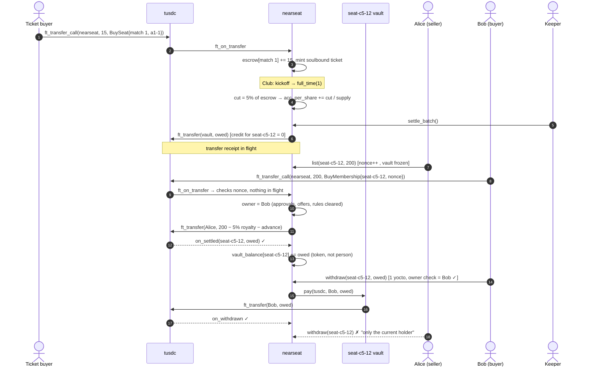
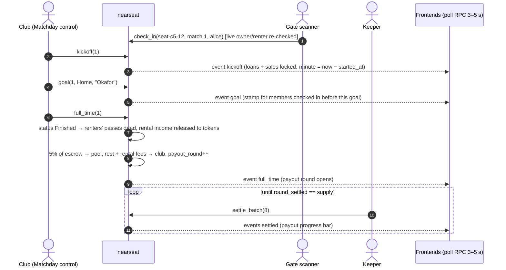

# NearSeat architecture

## Accounts (testnet)

| Account | What runs there | Keys after final deploy |
|---|---|---|
| `nearseat.testnet` | Main contract: NEP-171 memberships + single-match tickets, pool, matchday, market, gate | **None** (deleted; see README "Verify") |
| `seat-<stand><row>-<n>.nearseat.testnet` | One per membership. Vault code (global contract, by hash) | **None, ever** (created without `AddKey`) |
| `tusdc.nearseat.testnet` | tUSDC test token (NEP-141 + NEP-145, open faucet) | Deployer key (it's a test token) |
| `illiastars.testnet` | The club: fixtures, matchday control, top-ups | Club's wallet |
| `gate.illiastars.testnet` | Gate scanner: `check_in` | Scanner device key (rotatable by club) |
| relayer account | Pays gas for NEP-366 delegate actions | Relayer server |

`nearseat.testnet` must be the parent of the vaults: on NEAR only the parent
account can create `x.nearseat.testnet`.

## Contracts

```
contracts/
  vault/     ~60 lines. Stateless. pay(token, receiver, amount) — parent-only.
  nearseat/  main contract (modules below)
  tusdc/     NEP-141 test token
  mock-ft/   TEST ONLY token that fails transfers on demand
```

`nearseat` modules: `membership` (mint + NEP-171/177/178/181), `money` (pool,
settlement, withdrawals, callbacks), `payments` (`ft_on_transfer` router),
`matchday`, `lending`, `market` (resale + NEP-199), `gate`, `views`, `svg`,
`events`, and Layer 2 `advance`, `autolend`, `voting`.

## How control passes on transfer

1. The vault obeys one account: `nearseat.testnet` (`predecessor == parent`).
2. `nearseat.testnet` acts on a vault only inside a method that first reads the
   token's **current** `owner_id` from NEP-171 state, in the same receipt.
3. So whoever the NFT ledger says owns `seat-c5-12` *is* the only person who can
   move `seat-c5-12.nearseat.testnet`'s money. Changing the NFT owner changes
   vault control atomically: there is nothing else to hand over.
4. Money owed but not yet in the vault (pool share, loan income) is keyed by
   token, so it moves too. Inventory (credits, stamps, attendance) is token state.

## Data flow: ticket sale → revenue share → settlement → sale mid-settlement → buyer withdraws



## Matchday: kickoff → goal → full time → payout



## Off-chain pieces

- **web/**: React + Vite. Reads with plain RPC `view` calls every 3–5 s
  (`get_feed`, `get_match`, `membership`); writes through Wallet Selector or
  the relayer (NEP-366).
- **relayer/**: Express. `/relay` submits user-signed delegate actions to an
  allow-list of receivers and methods. `/members` serves the members-only page
  after an NEP-413 proof and a live `nft_token` owner check. `/gate/verify`
  verifies gate-pass QR payloads.
- **keeper/**: Node script. `settle_batch`, `process_refunds`,
  `execute_autolend`, and `demo-match` for the seeded end-to-end run.
